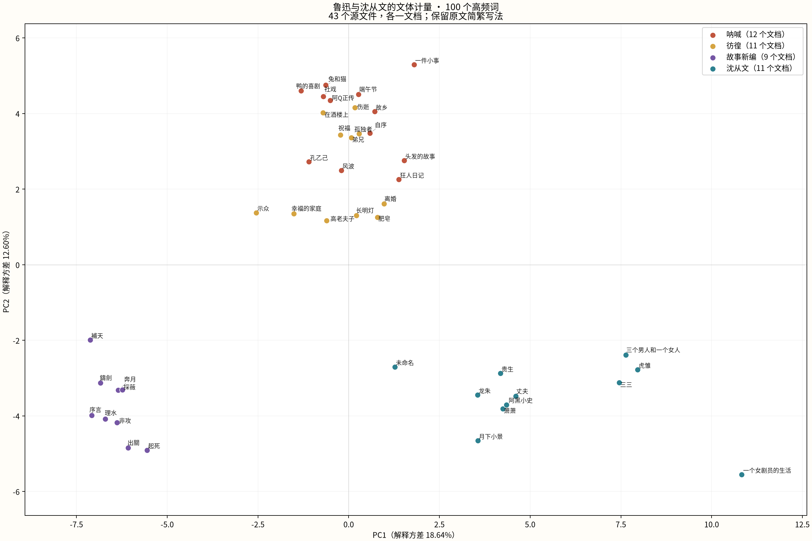

# CHI3242 第 8 周文体计量练习报告

日期：2026 年 10 月 29 日。练习来源：[第 8 周讲义](https://mcjkurz.github.io/teaching/courses/2026-2027/CHI3242/notes/week-08/)。

本次完成了指定四组语料的下载、分词、100 特征文体计量、PCA 和统计导出，并比较了 30 与 300 特征。100 特征的二维图中，两位作者的文本分区明显；《呐喊》与《彷徨》较接近，《故事新编》单独成组。不过，《故事新编》的繁体写法与其他集合的简体写法形成混杂，部分源文件也有拼接和乱码，因此不能把图上的差异全部解释成作者风格。

## 一、数据与预处理

使用 shallow sparse clone 获取 [qhchina-data 的四个指定目录](https://github.com/mcjkurz/qhchina-data/tree/a62187705288592cc150bf57bd0b4c7d50f4f693/corpora/authors)，固定提交为 `a62187705288592cc150bf57bd0b4c7d50f4f693`。没有下载其他语料目录。

| 作者 | 文集标签 | 源文件数 | 原始字符数 | 分词后词元数 |
| --- | --- | ---: | ---: | ---: |
| 鲁迅 | 呐喊 | 12 | 70,249 | 38,314 |
| 鲁迅 | 彷徨 | 11 | 78,655 | 41,724 |
| 鲁迅 | 故事新编 | 9 | 66,615 | 32,952 |
| 沈从文 | 沈从文 | 11 | 215,537 | 118,467 |
| 合计 | | **43** | **431,056** | **231,457** |

每个 `.txt` 文件完整保留为一个文档，不切成片段。全部文件可按 UTF-8 读取，均生成了非空词表，失败清单为空。原始字符数包括标点与空白。

分词前把所有非 Unicode 字母／数字字符换成空格，避免直接删除标点后拼接两侧文字。使用 jieba 默认精确模式与 HMM，仅保留完全由字母／数字组成的 token；不删除停用词、不做简繁转换，也不手动清理源文本正文。鲁迅三集的作者标签统一为“鲁迅”，同时保留不同文集标签。

必须注意，“43 个文档”不等于 43 篇经过校勘的独立小说：

- 语料包含《自序》《序言》，本次按文件口径保留。
- `孔乙己.txt` 实际连着《孔乙己》《药》《明天》三篇正文，PCA 中仍对应一个点。
- 《故事新编》主要为繁体，其他集合主要为简体；“说”和“說”等写法会被视为不同词。
- 部分文件含可见乱码与私用区字符；能用 UTF-8 解码不表示内容无误。

具体证据和源文件行号见[语料质量说明](corpus_quality_notes.md)。本报告的结论仅适用于这份指定语料。

## 二、100 特征分析与导出

按照 [qhchina 官方方法](https://www.qhchina.org/docs/stylometry/)，把作者映射到该作者的分词文档列表，拟合 `Stylometry(n_features=100, distance="cosine")`，保留默认 z-score。全局累计词元数最高的 100 个词成为同一组特征。

对第 i 篇文档、第 j 个词，先计算 `相对词频 = 该词次数 / 该篇全部词元数`，再跨全部 43 篇文档计算均值与总体标准差（`ddof=0`），得到 z-score。各篇在标准化中等权；并非把所有文档合并后才计算一个总频率。

使用 qhchina 已拟合的 `document_vectors` 直接做 `PCA(n_components=2, svd_solver="full")`。`distance="cosine"` 是模型距离方法的设置，PCA 输入仍是文档的 z 向量。

| 主成分 | 解释方差 |
| --- | ---: |
| PC1 | 18.64% |
| PC2 | 12.60% |
| 合计 | **31.24%** |

图中共有 43 个点，与 43 个源文件逐一对应。其余约 68.76% 的方差没有显示在这张二维图中。

[打开离线交互图](pca_interactive.html)，可切换特征数、悬停查看文档信息、平移缩放、按图例开关文集、显示篇名并重置视图。

主要统计文件：

- [文档坐标 CSV](story_coordinates_100.csv)：43 行数据，含文档 ID、作者、文集、源文件、词元数、PC1、PC2。
- [全局 100 个特征](selected_features_100.csv)：100 行数据。
- [各集特征统计](top_features_by_collection_100.csv)：四集各 100 行，共 400 行。同一全局词表在各集内按词元总次数排名，保留出现次数为 0 的词。
- [分词与元数据](story_tokens.jsonl)及[元数据 CSV](story_metadata.csv)。

特征 CSV 中，每万词频以该集全部词元数为分母；`collection_mean_corpus_zscore` 则是该集中每篇文档的 qhchina z-score 等权均值，以整个语料为标准化基准。前者受到长篇文本更多影响，后者每篇权重相同，不能互相替代。

## 三、观察题回答

### 1. 鲁迅和沈从文能分开吗？有没有“站错边”的文本？

100 特征图上分区较清楚：沈从文文档主要位于右下方，《呐喊》《彷徨》主要位于上方，《故事新编》主要位于左下方。沈从文的《一个女剧员的生活》位于组内较远的位置，但仍处于沈从文分区；“未命名”文档较靠近中间，应保留源名，不擅自推定篇名。

为了给“站错边”一个可重复的描述标准，本次比较每个点到两位作者**二维质心**的欧氏距离。100 特征下，没有文档更靠近另一作者的质心。但这只是对图形的概括：质心使用了同一批文档，未做留出验证，不能报告为“作者识别准确率 100%”，也不能用它证明作者归属。

### 2. 鲁迅三部小说集彼此靠近吗？《故事新编》有什么不同？

《呐喊》和《彷徨》有明显靠近与交叠。100 特征下，它们的二维质心分别约为 `(0.15, 3.81)`、`(-0.28, 2.41)`；《故事新编》的质心约为 `(-6.48, -3.75)`，与前两集相距较远。

题材、叙述方式等可能影响词汇使用，但本次最直接可见的混杂来自简繁写法。《故事新编》中，“說”的平均 z-score 为 `+1.755`；简体特征“来”“这”“还”“一个”在该集合中的计数均为 0，其平均 z-score 显著为负。这主要不能解释成作者不用这些词，因为原文中的繁体形式及其分词结果不同。

因此，本次可以说“原始语料的《故事新编》在特征空间中明显不同”，尚不足以说“差异完全来自文学风格”。进一步研究可另建统一简繁、校正拼接和乱码的版本，再与本次结果比较。

### 3. 哪些词的平均 z-score 特别高或低？是虚词还是内容词？

下表来自 100 特征 CSV。数值为该集各文档的平均 z-score，按全语料标准化；正值表示高于全语料文档平均水平，负值表示低于平均水平。

| 文集 | 较高的例子 | 较低的例子 |
| --- | --- | --- |
| 呐喊 | 便 `+1.250`、没有 `+1.121`、却 `+0.971` | 就 `−1.031`、她 `−0.624`、得 `−0.618` |
| 彷徨 | 起来 `+0.937`、已经 `+0.932`、但 `+0.902` | 到 `−0.704`、把 `−0.686`、才 `−0.617` |
| 故事新编 | 說 `+1.755`、得 `+0.997`、一 `+0.709` | 来 `−1.596`、这 `−1.578`、还 `−1.554` |
| 沈从文 | 把 `+1.560`、到 `+1.398`、为 `+1.352` | 和 `−1.196`、也 `−1.164`、但 `−0.975` |

“便、却、但、也”等主要承担副词、连词等语法功能；“把、到、为”等还需结合上下文区分词性和功能。“她”是代词。“起来、没有”也不能简单按内容名词处理。它们说明高频语法词、代词与常见表达确实参与了分组。

特征中也有“说／說”“事情”等动词或名词。沈从文集合的“事情”平均 z-score 约为 `+1.216`；内容词也在影响结果，因此不能把全部 100 个特征都称为“虚词”。《故事新编》的“說”尤其受到简繁混杂影响。

### 4. 改成 30 或 300 个特征后，图有什么变化？

| 特征数 | PC1 | PC2 | 合计解释方差 | 更靠近另一作者二维质心的文档数 |
| ---: | ---: | ---: | ---: | ---: |
| 30 | 22.98% | 13.18% | 36.15% | 6 |
| 100 | 18.64% | 12.60% | 31.24% | 0 |
| 300 | 15.42% | 11.39% | 26.81% | 0 |

30 特征时，分区更容易交叠。按上述二维质心的描述标准，《彷徨》的《离婚》《肥皂》《长明灯》，以及沈从文的《月下小景》《未命名》《龙朱》，更靠近另一作者的质心。它们是值得回看原文的个案，不能据此判定误署作者。

100 与 300 特征时，《呐喊》《彷徨》靠近、《故事新编》与沈从文分别成组的总体结构较稳定。特征数增加后，前两轴解释方差的比例降低，说明更多变化分散到其他维度；不能据此直接判断 300 特征“更差”。三次 PCA 各自拟合，坐标轴方向、尺度和具体数值也不能直接逐点比较。

可在[同一交互图](pca_interactive.html)中切换，或查看 [30 特征 PNG](pca_30.png) 与 [300 特征 PNG](pca_300.png)。本次没有使用外部测试集，也没有据此选出“最佳作者识别模型”。

## 四、验证与复现

已核验来源散列、每篇词表、元数据与向量顺序。独立重算相对词频和总体标准差得到的 z-score，与 qhchina 文档向量一致；保存的 PCA 载荷也能重建导出的坐标。三组坐标均为 43 行，特征统计分别为 120、400、1,200 行，各集分别为 30、100、300 行。PNG 可以完整解码，中文字体已通过 `from qhchina import load_fonts; load_fonts()` 加载；HTML 数据已内嵌，没有未填充的数据占位符。

数值检查见 [validation.json](validation.json)，浏览器实际交互检查见 [browser_validation.json](browser_validation.json)，源数据及其限制见[语料质量说明](corpus_quality_notes.md)。运行方式、环境版本和输出说明见[项目 README](../README.md)。
